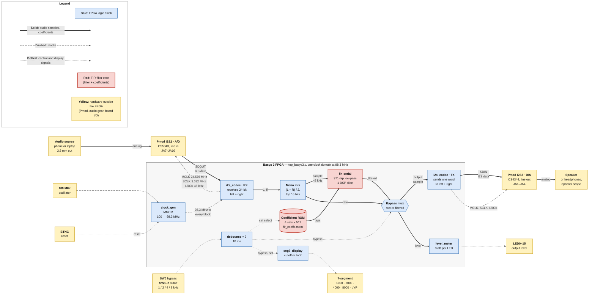

# FPGA Audio FIR Filter

FIR filter team project for EC551 class (Fall 2026) with Francis, Tanner, Alex and Dill.

This project shows a digital filter working in real time, in a way people can hear. Music or a voice goes into an FPGA, a low-pass FIR (finite impulse response) filter removes the high frequencies, and the result plays on a speaker. One switch (SW0) toggles between the raw and the filtered audio, so the treble cutting out is obvious straight away. Two more switches (SW1–2) choose the cutoff: 1, 2, 4 or 8 kHz. The LEDs show the output level and the 7-segment display shows the cutoff, so each step can be seen as well as heard.

The code covers the whole path, from filter design to a board you can program:

- **Filter design (Python):** `fir_design.py` designs four 371-tap low-pass filters with a Kaiser window, rounds their coefficients to 16 bits and checks that each still meets its specification.
- **Hardware design (Verilog):** a serial multiply-accumulate filter that needs a single DSP slice. Around it are an I2S interface to the audio converters, a bypass switch, debounced controls, a level meter and a display driver.
- **Verification:** two simulation tests check the Verilog against a Python model of the arithmetic, first for the filter alone and then for the whole system talking to models of the audio chips.

The target is a **Digilent Basys 3** board with a **Digilent Pmod I2S2** audio module on header JA. The filter itself is portable to any FPGA with a multiplier and block RAM. Every part has been checked in simulation; see [Verification](#verification).

## System diagram



**Key:** the colour of a block says where it is. **Blue** blocks are logic inside the FPGA; **red** blocks are the FIR filter core (`fir_serial` and its coefficient ROM); **yellow** blocks are hardware outside the FPGA: the Pmod I2S2 converters, the audio source and speaker, and the board's oscillator, button, switches, LEDs and display. The line style says what a connection carries. **Solid** lines carry audio samples and filter coefficients; **dashed** lines carry clocks; **dotted** lines carry control and display signals. The diagram has the same legend in its top-left corner. If it doesn't render, see [`docs/system_diagram.png`](docs/system_diagram.png).

**How the blocks interact, one sample at a time (every 20.8 µs):**

1. `clock_gen` turns the 100 MHz oscillator into the 98.3 MHz system clock that runs every block.
2. `i2s_codec` divides that clock into MCLK, SCLK and LRCK for both converters, and shifts in the left and right samples from the A/D converter.
3. The mono mix averages the two channels and passes the top 16 bits to `fir_serial`, and also to the bypass mux as the raw sample.
4. `fir_serial` multiplies the last 371 samples by the coefficient set chosen by SW1–2 (one multiply per clock) and outputs the filtered sample 376 clocks later.
5. The bypass mux picks the raw or filtered sample according to SW0, and `i2s_codec` sends it to both channels of the D/A converter.
6. `level_meter` lights LED0–15 from the output level, and `seg7_display` shows the selected cutoff or `bYP`. `debounce` cleans up all three switches first.

## Filter at a glance

| Parameter | Value |
| --- | --- |
| Sample rate | 48 kHz |
| Type | Linear-phase low-pass, Kaiser window, 371 taps (Type I) |
| Cutoffs (−6 dB) | 1, 2, 4, 8 kHz, selected by SW1–2 |
| Transition width | 500 Hz (passband edge = cutoff − 250 Hz, stopband edge = cutoff + 250 Hz) |
| Stopband attenuation | ≥ 63 dB after 16-bit rounding (spec: 60 dB) |
| Passband ripple | ≤ 0.015 dB |
| Group delay | 185 samples = 3.85 ms |
| Coefficients | 16-bit signed Q1.15, 4 sets × 512 words |
| Hardware | Serial MAC: 1 DSP48 slice, 376 clocks per output (of 2,048 available) |

## Components

### Hardware

| Item | Purpose | Notes |
| --- | --- | --- |
| Digilent Basys 3 (Artix-7 `xc7a35tcpg236-1`) | Runs the design | Uses the 100 MHz clock, SW0–SW2, BTNC, 16 LEDs, the 7-segment display and header JA |
| Digilent Pmod I2S2 | 24-bit audio ADC (line in) and DAC (line out) | Plug into **JA**; set jumper **JP1 to Slave (SLV)** |
| Audio source | Signal to filter | Phone or laptop with a 3.5 mm output; a tone-generator or sweep app is useful |
| Powered speaker or headphones | Audible output | Plug into the Pmod I2S2 line-out jack |
| Two 3.5 mm stereo cables | Source → line in; line out → speaker | |
| Micro-USB cable | Programming and power | |
| Oscilloscope (optional) | Shows input against output | CH1 on the source, CH2 on line out |

**Other boards:** an Arty A7 works with the same RTL and a new XDC; it has no 7-segment display, so leave `seg7_display` unconnected. A Nexys A7 can use its onboard PDM microphone and PWM audio output instead of the Pmod. That needs a PDM decimator in front of the filter and a PWM modulator in place of `i2s_codec`.

### Files

**FPGA design (RTL)**

| File | What it is |
| --- | --- |
| `top_basys3.v` | Top level: wires the blocks below to the board's pins |
| `clock_gen.v` | MMCM: 100 MHz → 98.305 MHz system clock (4 × the codec's 24.576 MHz master clock) |
| `i2s_codec.v` | I2S master for the Pmod I2S2: generates MCLK, SCLK and LRCK, receives both ADC channels and sends one word to both DAC channels |
| `fir_serial.v` | Serial-MAC FIR filter: delay line, coefficient ROM, multiply-accumulate, rounding and saturation |
| `debounce.v` | Synchronizes a switch and accepts a change after 10 ms of stable input |
| `level_meter.v` | 16-LED peak meter, 3 dB per LED |
| `seg7_display.v` | Shows the cutoff (1000, 2000, 4000, 8000) or "bYP" in bypass |
| `basys3_pmod_i2s2.xdc` | Pin and timing constraints for the Basys 3 with the Pmod on JA |
| `fir_coeffs.mem` | Coefficient ROM image loaded by `fir_serial.v` (`$readmemh`, one hex word per line) |

**Design and verification**

| File | What it is |
| --- | --- |
| `fir_design.py` | Designs the four coefficient sets (SciPy), quantizes them to Q1.15, reports the measured response and writes the coefficient files |
| `fir_coeffs.coe` | The coefficient image for a Vivado Block Memory Generator, if you prefer an IP ROM (2,048 × 16, radix 16) |
| `fir_coeffs.csv` | Coefficients as a table (tap × set), for inspection |
| `tb_fir_serial.v`, `check_sim.py` | Filter-only test: all four sets, bit-exact against a Python fixed-point model |
| `tb_top.v`, `check_top.py` | Whole-system test: models the Pmod's ADC and DAC over I2S, then checks bypass, filtering, LEDs and display |
| `docs/system_diagram.mmd`, `docs/system_diagram.png` | Source and rendered image of the system diagram (re-render with `mmdc -i docs/system_diagram.mmd -o docs/system_diagram.png`) |

### How the design works

| Block | Detail |
| --- | --- |
| Clocking | One clock domain at 98.305 MHz (MMCM: × 7.25, ÷ 7.375; +11 ppm). Codec clocks are counter divisions: MCLK = ÷ 4 (24.576 MHz, 512 × fs), SCLK = ÷ 32 (3.072 MHz, 64 × fs), LRCK = ÷ 2048 (48 kHz) |
| Audio frame | 2,048 system clocks per sample. I2S, 24-bit, MSB one SCLK after the LRCK edge, 32 bit-slots per channel |
| Input | Left and right are averaged, (L + R) / 2, and the top 16 bits go to the filter |
| Filter | Starts when the right channel arrives; finishes 376 clocks later |
| Bypass | The raw sample is delayed to step with the filtered one, so SW0 switches between two time-aligned signals. Both paths reach the DAC 2 frames (42 µs) after the ADC, plus the filter's own 3.85 ms delay on the filtered path |
| Output | The 16-bit result is sent as the top of a 24-bit word, on both DAC channels |
| Reset | BTNC, or the MMCM losing lock |

### `fir_serial` interface

| Port | Dir | Width | Description |
| --- | --- | --- | --- |
| `clk` | in | 1 | System clock |
| `rst` | in | 1 | Synchronous reset, active high |
| `in_valid` | in | 1 | One-cycle strobe when a new sample arrives |
| `in_sample` | in | 16 | Signed sample, Q1.15 |
| `set_sel` | in | 2 | Coefficient set (SW1–2), latched at the start of each sample |
| `out_valid` | out | 1 | One-cycle strobe when the filtered sample is ready |
| `out_sample` | out | 16 | Filtered sample, rounded and saturated |
| `busy` | out | 1 | High while a sample is being processed (376 clocks) |

Parameters: `N` (taps, 371), `DW`/`CW` (data and coefficient width, 16), `AW` (accumulator width, 40), `LW` (log2 of the delay-line depth, 9) and `COEF_FILE` (`"fir_coeffs.mem"`).

### Pin assignments (Basys 3)

| Signal | Pin | Board label | Signal | Pin | Board label |
| --- | --- | --- | --- | --- | --- |
| `tx_mclk` | J1 | JA1 (D/A MCLK) | `rx_mclk` | H1 | JA7 (A/D MCLK) |
| `tx_lrck` | L2 | JA2 (D/A LRCK) | `rx_lrck` | K2 | JA8 (A/D LRCK) |
| `tx_sclk` | J2 | JA3 (D/A SCLK) | `rx_sclk` | H2 | JA9 (A/D SCLK) |
| `tx_sdin` | G2 | JA4 (D/A SDIN) | `rx_sdout` | G3 | JA10 (A/D SDOUT) |
| `sw[0]` | V17 | SW0: bypass | `btnC` | U18 | BTNC: reset |
| `sw[1]` | V16 | SW1: cutoff bit 0 | `clk` | W5 | 100 MHz oscillator |
| `sw[2]` | W16 | SW2: cutoff bit 1 | `led[15:0]`, `seg`, `an`, `dp` | see XDC | LEDs, 7-segment display |

## Step-by-step setup

### 1. Install the tools

- **Python 3** with NumPy and SciPy: `pip install numpy scipy`
- **Icarus Verilog** for simulation: `sudo apt install iverilog` (Linux) or `brew install icarus-verilog` (macOS)
- **AMD Vivado** (the free Standard edition supports the Artix-7 on the Basys 3)

### 2. Generate the coefficients (optional)

The coefficient files are already in the repo. Regenerate them only if you change the specification at the top of `fir_design.py` (cutoffs, transition width, attenuation):

```bash
python3 fir_design.py
```

Expected output: 371 taps, and every set showing a stopband of at least 63 dB.

```
taps=371 beta=5.984 delay=185 samples (3.85 ms)
set 0: fc=1000 ... stop=63.4 dB ...
set 1: fc=2000 ... stop=63.5 dB ...
set 2: fc=4000 ... stop=63.0 dB ...
set 3: fc=8000 ... stop=63.7 dB ...
```

### 3. Simulate

Run the filter test, then the whole-system test (each takes a few minutes):

```bash
python3 check_sim.py
python3 check_top.py
```

`check_sim.py` should report 0 mismatches for all four sets. `check_top.py` should end with `PASS`:

```
SW=001 (bypass): 1300 DAC words, latency 2 frames, mismatches 0, display 'bYP ', 16 LEDs lit
    tones at DAC: 500 Hz -0.0 dB, 3 kHz +0.0 dB, 10 kHz -0.0 dB
SW=000 (1 kHz): 1300 DAC words, latency 2 frames, mismatches 0, display '1000', 13 LEDs lit
    tones at DAC: 500 Hz -0.0 dB, 3 kHz -80.0 dB, 10 kHz -81.4 dB
SW=110 (8 kHz): 1300 DAC words, latency 2 frames, mismatches 0, display '8000', 15 LEDs lit
    tones at DAC: 500 Hz -0.0 dB, 3 kHz +0.0 dB, 10 kHz -79.6 dB
PASS
```

Don't go to hardware until both pass.

### 4. Build the bitstream in Vivado

1. **Create a project:** File → Project → New → RTL Project. Part: `xc7a35tcpg236-1`, or select the Basys 3 board if its board files are installed.
2. **Add design sources:** `top_basys3.v`, `clock_gen.v`, `i2s_codec.v`, `fir_serial.v`, `debounce.v`, `level_meter.v`, `seg7_display.v` and `fir_coeffs.mem`. Vivado picks up the `.mem` file when it is a design source; if synthesis can't find it, set `COEF_FILE` in `fir_serial.v` to its full path.
3. **Add constraints:** `basys3_pmod_i2s2.xdc`.
4. **Set the top module** to `top_basys3`. Do not add the testbench files to the design sources.
5. **Run synthesis.** In the log, check that `$readmemh` read `fir_coeffs.mem` without a warning.
6. **Run implementation**, then check the reports:
   - Timing: WNS must be positive (no failing paths at 98.3 MHz).
   - Utilization: the filter should use 1 DSP48 and 1.5 block RAMs (36 Kb).
7. **Generate the bitstream**, open the Hardware Manager, connect to the board and program it.

### 5. Set up the bench

1. Set jumper **JP1 on the Pmod I2S2 to SLV** (slave). The FPGA drives the codec clocks.
2. Plug the Pmod I2S2 into **JA**, with its pin 1 in JA1.
3. Connect the phone's headphone output to the Pmod's **line-in** jack.
4. Connect the Pmod's **line-out** jack to the powered speaker or headphones.
5. Optional: scope CH1 on the source signal, CH2 on line out.
6. Set all switches down and the phone volume to about 70%. Full-scale input can clip on the 4 kHz and 8 kHz settings.
7. Power the board over USB and program it (step 4). The display shows `1000`.

### 6. Run the demonstration

| Step | Switches (SW2 SW1 SW0) | What the audience sees and hears |
| --- | --- | --- |
| 1 | 0 0 **1** (bypass) | Full-range music; the display shows `bYP` and the LEDs track the level |
| 2 | 0 0 **0** | Filter on at 1 kHz: the treble disappears, voices sound muffled, the LEDs drop on bright passages. The display shows `1000` |
| 3 | 0 1 0 → 1 0 0 → 1 1 0 | The cutoff rises to 2, 4 and 8 kHz and the sound gets brighter at each step. The display follows |
| 4 | any filter setting; play a 20 Hz–20 kHz sweep | The sound cuts off sharply at the selected frequency, and the scope trace collapses past it |
| 5 | Flip SW0 back and forth | The A/B comparison: the clearest moment of the demo |


## Verification

| Test | Result |
| --- | --- |
| Filter alone (`check_sim.py`), 4 sets × 1,200 samples | 0 mismatches against the Python fixed-point model; full-scale overload saturates instead of wrapping |
| Whole system over I2S (`check_top.py`), bypass, 1 kHz and 8 kHz | Bypass reproduces the input exactly; filtered output matches the model with 0 mismatches; tones in the stopband are down 79–81 dB; the display shows `bYP`, `1000` and `8000`; the LED count follows the output level |
| Hardware | Not yet built in Vivado or tested on a board |


## Changing the filter

1. Edit the constants at the top of `fir_design.py`: `CUTOFFS`, `TRANSITION`, `ATTEN_DB`.
2. Run `python3 fir_design.py` and check that every set meets the stopband target.
3. If the tap count changed, update `N` in `fir_serial.v` and `TAPS` in `check_sim.py` and `check_top.py`. Keep it at 511 or fewer so each set fits its 512-word slot.
4. Run both checks and confirm they pass.
5. Rebuild the bitstream.

A narrower transition band needs more taps: halving it to 250 Hz roughly doubles the count to about 740. That needs 1,024-word slots (`LW = 10`), but still fits easily in the 2,048 clocks available per sample. If you also change the display values, edit `seg7_display.v`.
